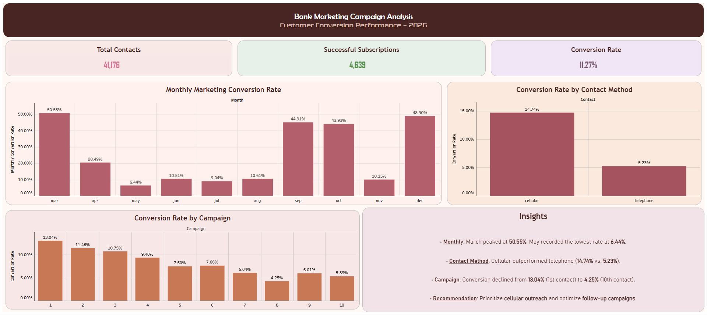

# Marketing Funnel & Conversion Performance Analysis

## 📊 Project Overview

This project analyzes bank marketing campaign data using Python and Tableau Public. The goal is to evaluate customer conversion patterns, compare campaign performance, and identify opportunities to improve subscription rates.

## 🎯 Objectives

- Analyze monthly marketing conversion rates.
- Compare conversion rates across contact methods.
- Evaluate conversion rates by number of campaign contacts.
- Identify trends in successful customer subscriptions.
- Develop actionable, data-driven marketing recommendations.

## 🛠️ Tools Used

- Python
- Pandas (if used)
- Tableau Public
- Data visualization and exploratory analysis
- Conversion rate analysis and KPI tracking

## 📈 Key Findings

- **Monthly Performance:** March recorded the highest observed conversion rate at approximately 50.55%, while May recorded the lowest at approximately 6.44%.
- **Contact Method:** Cellular contacts achieved a conversion rate of approximately 14.74%, compared with 5.23% for telephone contacts.
- **Campaign Contacts:** The conversion rate was approximately 13.04% on the first contact and 4.25% on the eighth contact.

## 💡 Recommendations

- Prioritize cellular outreach while monitoring channel performance.
- Investigate monthly variations to identify effective marketing periods.
- Optimize follow-up frequency and avoid unnecessary repeated contacts.
- Use conversion metrics to guide future campaign decisions.

## 🖥️ Interactive Dashboard

[**View the Tableau Public Dashboard**](https://public.tableau.com/views/Task-3MarketingFunnelConversionPerformanceAnalysis/Dashboard1?:language=en-US&publish=yes&:sid=&:redirect=auth&:display_count=n&:origin=viz_share_link)

### Dashboard Preview

## 📂 Project Structure

- `TASK - 3 (Python)` — Python scripts for data cleaning and analysis.
- `Task - 3 (Marketing Funnel & Conversion Analysis/` — Packaged Tableau workbook (`.twbx`).
- `Screenshots` — Screenshots of charts and analysis.
- `dashboard-screenshot.png` — Main dashboard preview.
- `README.md` — Project documentation.

## 📚 Dataset

**Source:** [Click here to view Bank Marketing dataset](https://archive.ics.uci.edu/dataset/222/bank+marketing)

The dataset contains information about bank marketing contacts and customer subscription outcomes.

## 👨‍💻 Author

Abhinav Das

## 📌 Note

This project was completed as part of the Future Interns Data Science & Analytics Task 3 (2026). Findings describe observed associations in the dataset and do not establish causation.
